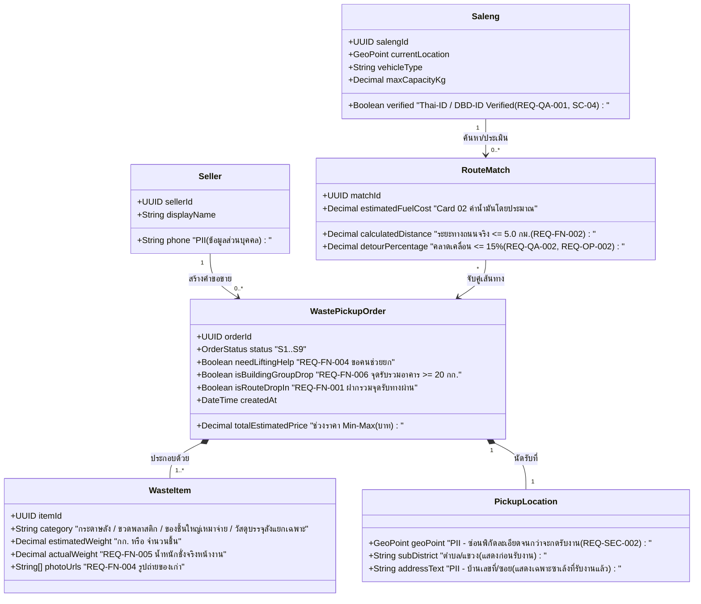

# ข้อจำกัดกลาง กฎธุรกิจ และโมเดลโดเมนหลัก (Shared Constraints, Business Rules & Domain Model)

เอกสารนี้อ้างอิงโดยตรงจาก **เอกสารสเปกของกลุ่ม 2** (หน้า 1–22: `SPEC-ROUTE`, `PLAN-ROUTE`, `TASKS-ROUTE`, `BL-01` และหน้า 57–63: `Studio 2` ถึง `Studio 6`) และเอกสาร Google Docs **`2569-517511-Requirement-Engineering`**

---

## 1. โมเดลโดเมนหลัก (`MD-DOM-04`)

---

## 2. แผนผังสถานะคำขอรับซื้อของเก่า 9 สถานะ (`MD-STM-04`)

| รหัสสถานะ | ชื่อสถานะ (TH / EN) | คำอธิบายและเงื่อนไขการเปลี่ยนสถานะ (`Transition Guard`) |
| :--- | :--- | :--- |
| **`S1`** | **ฉบับร่าง (`Draft`)** | ผู้ขายกำลังเลือกประเภทของเก่า กรอกปริมาณ แนบรูป หรือดูช่วงราคาประเมินเบื้องต้น (`UC-01`, `REQ-UX-002`) |
| **`S2`** | **รอผู้รับซื้อ / รอผู้รับงาน (`Pending / Open`)** | ผู้ขายยืนยันโพสต์ขายของเก่าและส่งคำขอนัดหมายผ่านเกณฑ์ขั้นต่ำ (`REQ-FN-001` `>= 500 บาท` หรือ `>= 2 กระสอบ` หรือเลือกฝากรวมทางผ่าน `UC-08` / จุดรับรวมหอพัก `>= 20 กก.` `REQ-FN-006`) |
| **`S3`** | **มีผู้รับงานแล้ว (`Assigned / Accepted`)** | ซาเล้งที่ผ่านการยืนยันตัวตน (`verified = true`) กดรับงานสำเร็จด้วย Optimistic Lock (`REQ-BR-002` / `BR-02`: 1 คำขอมีซาเล้งรับผิดชอบได้เพียงคนเดียว) และระบบเปิดเผย `addressText` + `geoPoint` ให้เฉพาะซาเล้งคนนั้น (`REQ-SEC-002`) |
| **`S4`** | **กำลังเดินทาง (`In-Transit`)** | ซาเล้งกดยืนยันออกเดินทางพร้อมระบบนำทาง GPS (`UC-09`) — **ล็อกปุ่มยกเลิกของผู้ขายทันทีตาม `BR-03`** |
| **`S5`** | **ถึงจุดนัดหมายและชั่งของ (`Arrived & Weighed`)** | ซาเล้งถึงบ้านผู้ขาย ชั่งน้ำหนักจริงแยกตามชนิดวัสดุ และกรอกตัวเลขน้ำหนักลงในระบบ (`REQ-FN-005`) |
| **`S6`** | **รอยืนยันชำระเงิน (`Pending Payment`)** | **ผู้ขายกดยืนยันตัวเลขน้ำหนักจริงบนหน้าจอของตนเองแล้ว (`REQ-FN-005` บล็อก 100% หากยังไม่กดยืนยัน)** ระบบจึงคำนวณยอดชำระสุทธิและรอการชำระเงิน (`เงินสด / QR Code / PromptPay / โอน` — `UC-06`, `UC-10`) |
| **`S7`** | **สำเร็จ / ปิดงาน (`Completed`)** | ชำระเงินและออกใบเสร็จดิจิทัลสำเร็จ (`SC-03`) พร้อมเปิดให้ผู้ขายรีวิวให้คะแนนซาเล้ง (`UC-11`) และบันทึกเป็น `"ซาเล้งที่เคยใช้บริการ"` (`REQ-UX-001`, `REQ-QA-001`) |
| **`S8`** | **ยกเลิก (`Cancelled`)** | ผู้ขายยกเลิกก่อนซาเล้งออกเดินทาง (`BR-03`) หรือซาเล้งยกเลิกพร้อมระบุเหตุผล (ระบบคืนสถานะใบงานกลับเป็น `S2` เพื่อหาซาเล้งคนใหม่โดยอัตโนมัติ) |
| **`S9`** | **ระงับชั่วคราว / ข้อพิพาท (`Disputed / Frozen`)** | เกิดข้อโต้แย้งเรื่องน้ำหนักหรือราคาหน้างาน (`UC-13`) ส่งเข้าศูนย์ควบคุมข้อพิพาทของ Admin (`Dispute Resolution`) |

---

## 3. กฎธุรกิจหลัก (`Business Rules`)

- **`BR-01` (การแสดงช่วงราคาประเมิน):** ราคาที่แสดงในระบบประเมินเบื้องต้นต้องเป็น **`"ช่วงราคา (ต่ำสุด–สูงสุด)"`** เสมอ ไม่ใช่ตัวเลขตายตัว เพื่อป้องกันความเข้าใจผิดก่อนชั่งจริงหน้างาน (`UC-01`, `Card 01`, `REQ-DAT-001`)
- **`BR-02` / `REQ-BR-002` (การล็อกสิทธิ์รับงาน 1 ต่อ 1):** คำขอรับซื้อหนึ่งรายการ (`WastePickupOrder`) มีซาเล้งรับผิดชอบได้เพียงคนเดียวเท่านั้น ต้องใช้ `Optimistic Locking (version field)` ป้องกันซาเล้ง 2 คนกดรับงานเดียวกันพร้อมกัน (`AC-04-06`, `P-04`)
- **`BR-03` (เงื่อนไขการยกเลิกนัดหมายของผู้ขาย):** ผู้ขายสามารถกดยกเลิกหรือแก้ไขนัดหมายได้ **เฉพาะก่อนที่ซาเล้งกดยืนยันออกเดินทาง (`S4: In-Transit`) เท่านั้น**

---

## 4. ข้อจำกัดด้านสถาปัตยกรรมและบริบทระบบ (`Constitutional Constraints`)

- **`CC-01` (Mobile-First SPA):** พัฒนาเป็นเว็บแอปพลิเคชันแบบ Mobile-First (`React / Next.js` หรือ `Flutter Web/Mobile`) รองรับหน้าจอสมาร์ตโฟนราคาประหยัด (`RAM >= 2 GB`, Android 9.0+)
- **`CC-02` (GPS Sync Interval):** ซิงก์พิกัด GPS ของซาเล้งทุก 60 วินาทีขณะเปิดสถานะพร้อมรับงาน (`Online`)
- **`CC-03` (Road Distance API & Haversine Fallback):** คำนวณระยะทางเดินทางจริงด้วย Routing API (OSRM / Google Routes API) ในรัศมี `<= 5.0 กม.` หาก API ล้มเหลวให้สลับใช้สูตรเส้นตรงคูณค่าชดเชยถนนจริง (`Haversine × 1.3`) อัตโนมัติ (`P-01`)
- **`CC-04` (Atomic Claim Transaction):** ใช้ `PostgreSQL + PostGIS` ร่วมกับ `Optimistic Concurrency Control (version column)` เพื่อรับประกันว่าไม่มีการรับงานซ้ำซ้อน (`P-04`)
- **`CC-05` (Offline Cache):** เก็บข้อมูลใบงานที่รับแล้วไว้ใน `IndexedDB / Local Storage` บนเครื่องซาเล้ง เพื่อให้เปิดดูรายการนัดหมายได้เมื่อไม่มีสัญญาณอินเทอร์เน็ต พร้อมป้ายแจ้งเตือน `"ข้อมูลอาจไม่อัปเดต"` และปิดปุ่มกดรับงานใหม่ (`REQ-OP-001`, `P-05`)
- **`CC-06` (PDPA & PII Masking):** ห้ามส่งค่า `addressText` และ `geoPoint` ละเอียดของผู้ขายผ่าน API ค้นหางาน (`GET /api/v1/orders/nearby`) ให้คืนเฉพาะชื่อตำบล/แขวง (`subDistrict`) และระยะทางโดยประมาณ จนกว่าซาเล้งจะกดรับงานสำเร็จ (`REQ-SEC-002`, `P-03`)
