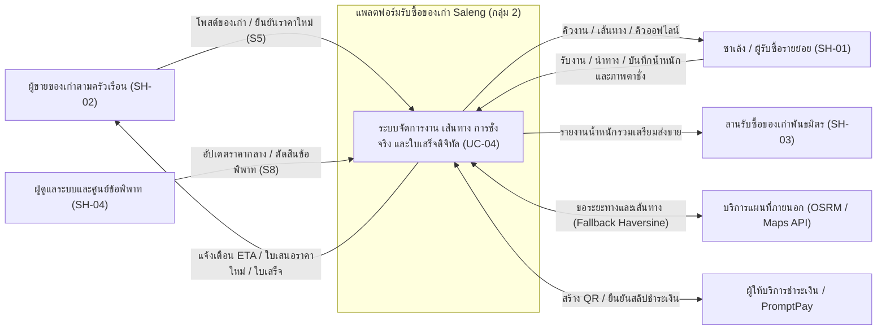
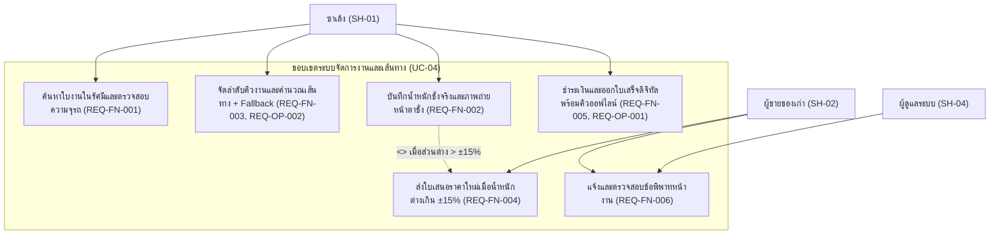
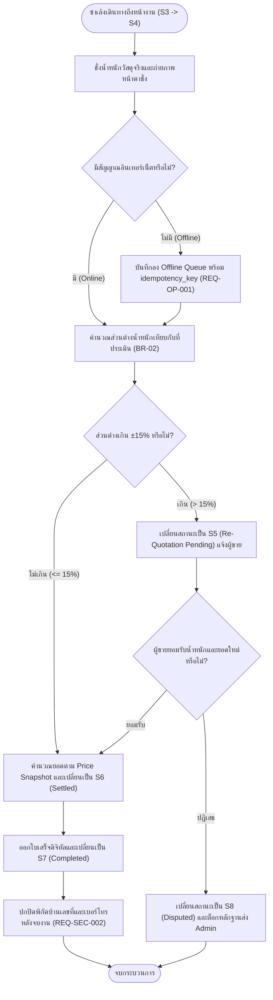
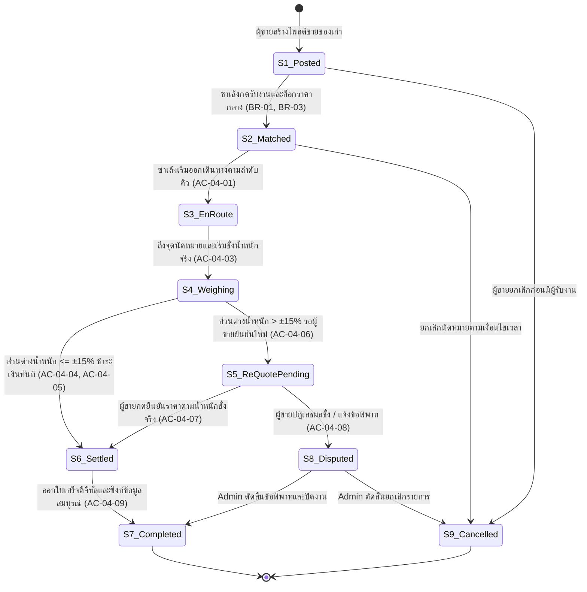
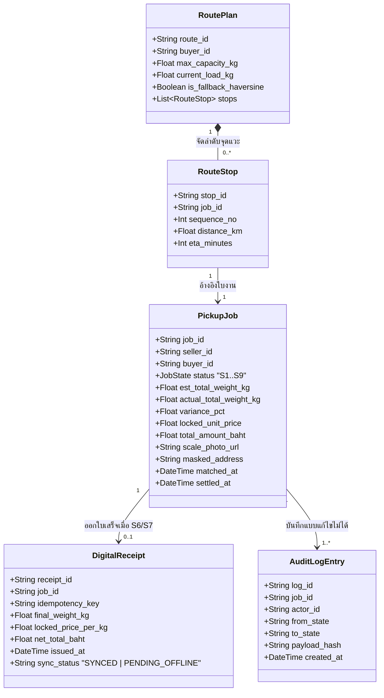
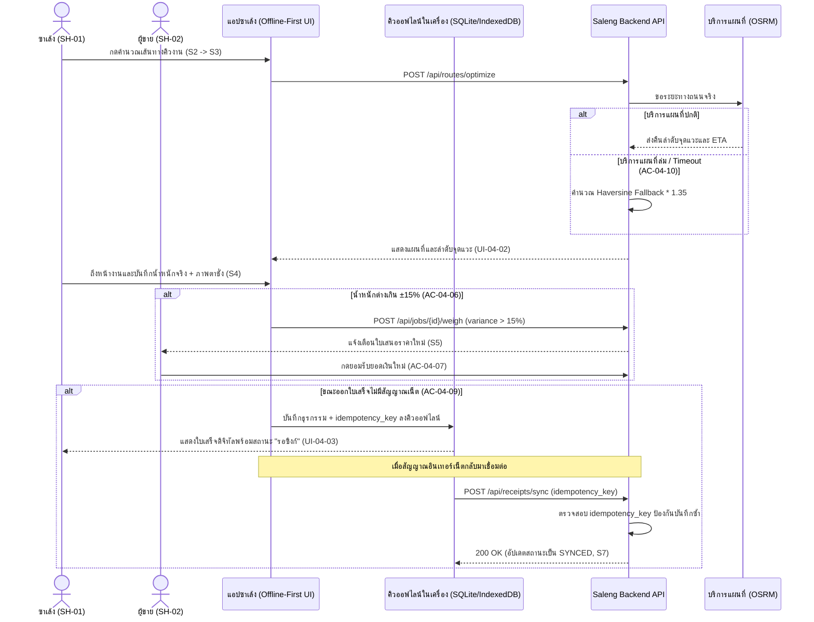

# โมเดลระบบและแผนภาพ (`models.md`) — ฟีเจอร์ `UC-04` การจัดการงานและเส้นทางของซาเล้ง

เอกสารนี้ประกอบด้วยโมเดลทั้ง 6 มุมมองของฟีเจอร์ `UC-04` (`MD-CTX-04`, `MD-UCD-04`, `MD-ACT-04`, `MD-STM-04`, `MD-DOM-04`, `MD-SEQ-04`) ที่สอดคล้องกับ `spec.md`, `rules.md`, และ `route.feature` ทุกประการ

---

## 1. Context Diagram (`MD-CTX-04`)

---

## 2. Use Case Diagram (`MD-UCD-04`)

---

## 3. Activity Diagram — กระบวนการชั่งน้ำหนักจริงและตรวจสอบส่วนต่าง ±15% (`MD-ACT-04`)

---

## 4. State Machine Diagram — วงจรชีวิตใบงาน `S1..S9` (`MD-STM-04`)

---

## 5. Domain Model (`MD-DOM-04`)

---

## 6. Sequence Diagram — การชั่งจริง โหมดออฟไลน์ และการซิงก์ใบเสร็จ (`MD-SEQ-04`)

